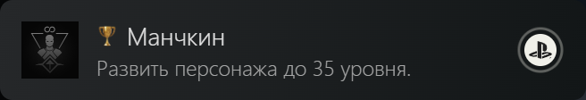
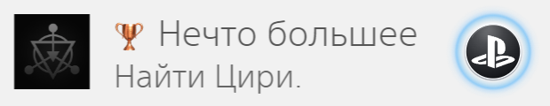
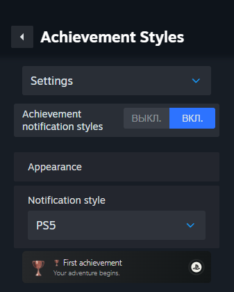

# Achievement Styles

A Millennium plugin that brings PS5, PS4 and Xbox achievement notifications to Steam.

It matches your Steam achievements with real PlayStation trophies and Xbox achievements, including trophy grades, PSN completion percentages, Xbox rarity and Gamerscore.

## Screenshots

**PS5**



**PS4**



**Xbox**


<details>
<summary>Settings</summary>



</details>

## Features

- PS5, PS4 and Xbox styles, or a random style for each notification.
- Steam or PSN achievement percentages and optional game progress.
- Separate settings for each game.
- Achievement history
- Completion platinum and Mythic notifications for supported games.
- English, Russian and Ukrainian interfaces.

PlayStation data is looked up through PSN Trophy Leaders, and Xbox data through XCT. Achievement names, descriptions and artwork stay as they are in Steam.

## Install

Requires Windows and [Millennium for Steam](https://steambrew.app/).

1. Download and extract the release archive.
2. Close Steam completely.
3. Copy `trophy-styles.star` into `<Steam install>/millennium/plugins`.
4. Start Steam and enable **Achievement Styles** in Millennium's plugin settings.

Open the plugin settings to choose a style. Changes save automatically. The **Preview** page lets you try notifications without unlocking achievements.

## Notes

- No PSN or Xbox account is needed. Some games or achievements may not have a match in the public catalogs.
- History records achievements earned while the plugin is running. It does not import previous unlocks.
- Completion notifications are extra popups, not new Steam achievements.
- Steam updates can require a plugin update.

Asset credits are in `NOTICE.md` in the release archive and `resources/NOTICE.md` in the source tree.

## Development

```sh
npm ci --ignore-scripts
npm run types
npm run build
```

`npm run check` checks TypeScript. `npm test` runs the tests and requires Google Chrome and a local Steam installation. Set `TROPHY_STEAM_BUNDLE` to your `steamui/sp.js` path if Steam is outside the default Windows directory.
